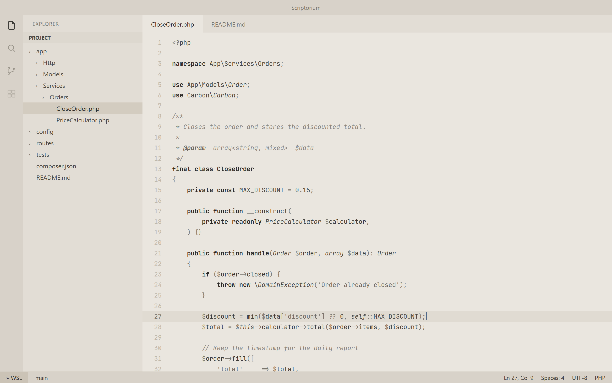
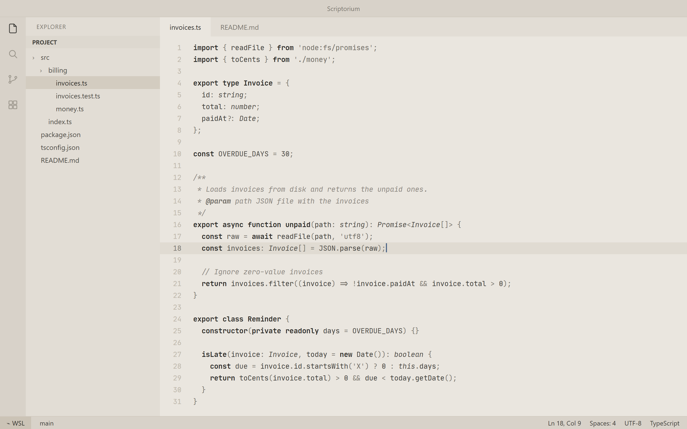

# Scriptorium

A quiet light theme on warm paper. **No colors in your code**: only grays, **bold** and *italic*.

Most themes paint every token a different color. After a few hours that gets tiring.
Scriptorium does the opposite: the code stays in ink tones on a cream page, and
structure shows up through weight and slant, like a well-typeset book.





## How code is highlighted

| What | Example | Style |
|---|---|---|
| Keywords | `public function`, `return`, `if`, `new`, `import` | **bold**, darkest ink |
| Declared names | the name after `function`, `class`, `interface` | **bold** |
| Types and classes | `string`, `Promise`, `Carbon` | *italic* |
| `this`, `self`, `null`, `true` | | *italic* |
| Everything else | variables, calls, properties | regular ink |
| Strings | `'utf8'` | lighter gray |
| Punctuation and operators | `( ) ; , -> =` and PHP's `$` | faded, so names stand out |
| Comments | `// ...` | *italic*, faded |
| Doc tags | `@param`, `@return` | ***bold italic*** inside the comment |

Diffs, syntax errors and Markdown follow the same rule: no red, no green.

## Palette

| | Hex | Used for |
|---|---|---|
| Paper | `#EAE6DF` | editor |
| Paper 2 | `#E2DDD5` | sidebar, tabs, panels, widgets |
| Paper 3 | `#D8D2C9` | activity bar, status bar, title bar |
| Ink | `#2B2A27` | keywords, declarations |
| Ink 2 | `#3B3A36` | code |
| Gray | `#6E6A63` | strings |
| Gray 2 | `#8C877E` | comments |

There is no `#FFFFFF` and no `#000000` anywhere in the theme. The UI keeps a few
muted earthy accents (slate cursor, olive/ochre/terracotta for git and
diagnostics), but the code itself is grayscale.

## Suggested settings

```jsonc
{
  "workbench.colorTheme": "Scriptorium",
  "editor.fontFamily": "JetBrains Mono",
  "editor.fontLigatures": true,
  "editor.semanticHighlighting.enabled": true,
  "editor.bracketPairColorization.enabled": false
}
```

Turning off bracket pair colorization keeps brackets gray too.

## Português

Tema claro em tom de papel, sem cor no código: só cinza, negrito e itálico.
Feito para quem cansou de ler código colorido. As palavras-chave e os nomes
declarados ficam em negrito, os tipos em itálico, e a pontuação recua para os
nomes aparecerem.

## License

[MIT](LICENSE)
